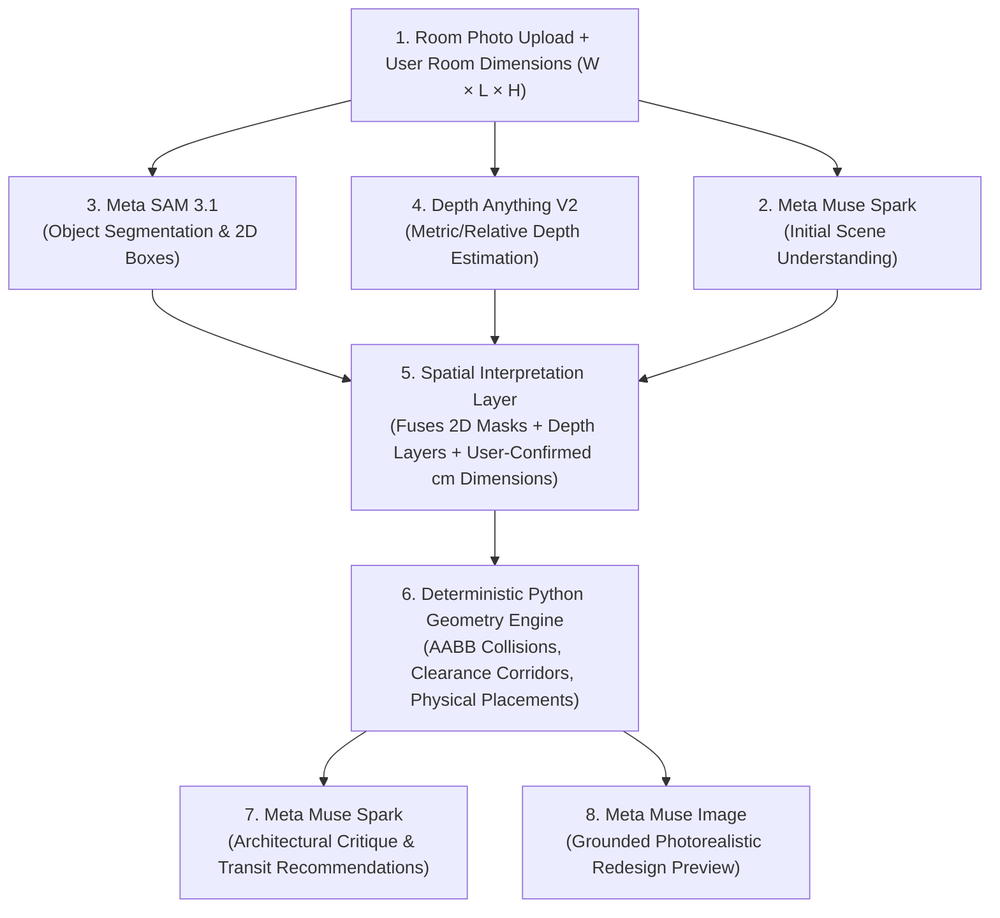

# Project Status – RoomGenius AI

## Day 4 — October 30, 2026 (IST)

---

### 🔎 Verified Starting State (Day 4 Start)

| Item | Status | Verified Evidence |
|------|--------|-------------------|
| **Git branch** | `day4-visualization` (created from `day3-layout-engine`) | `git status` clean, commit `9b8cb51` |
| **Filesystem / Tools** | ✅ Operational | Direct execution, no telemetry issues |
| **Backend** | ✅ Operational | FastAPI app, 39/39 pytest tests passing (`test_geometry.py`, `test_layout.py`) |
| **Frontend** | ✅ Operational | React + Vite + TS; `tsc --noEmit` 0 errors, `vite build` successful |
| **Day 3 Status** | ✅ 100% Complete | Pure AABB geometry engine, 0°/90° rotation, candidate anchor packing, CodeRabbit audit 0 findings |

---

### ✅ Completed Tasks & Verified Results (Day 4)

| # | Task | Status | Evidence |
|---|------|--------|----------|
| 1 | **SVG Room Visualizer Component** (`frontend/src/RoomVisualizer.tsx`) | ✅ Done | Native responsive React SVG component (`preserveAspectRatio="xMidYMid meet"`), room boundary with dimension callouts, placed furniture rectangles with category colors, rotation badges (90° indicator), and `<title>` tooltips. |
| 2 | **Dynamic Dimension Scaling** (`frontend/src/RoomVisualizer.tsx`) | ✅ Done | Derived scale factor `S = Math.max(1, Math.max(W, L) / 500)` applied dynamically to `PADDING`, font sizes, stroke widths, and text visibility thresholds so labels remain legible from 100 cm up to 2000 cm. |
| 3 | **Truthful Before/After Comparison Interface** (`frontend/src/App.tsx`, `App.css`) | ✅ Done | Side-by-side on desktop / stacked on mobile: "Before" displays an immutable snapshot of submitted inventory awaiting layout; "After" displays the interactive 2D floorplan. Includes room metrics (area, furniture footprint, utilization %, placement rate). |
| 4 | **Interactive Inspection & Highlighting** | ✅ Done | Cross-highlighting between SVG floorplan, inventory cards, and breakdown table with persistent selection, temporary hover, and accessible keyboard activation (Enter/Space, focus/blur). |
| 5 | **Quality & CodeRabbit Audit** | ✅ Done | 4 review iterations; all findings (hover/click separation, snapshot consistency, dynamic scaling, lazy initialization, keyboard accessibility) resolved. Final verification returned **0 findings**. |

---

### 📁 Files Created / Modified Today

```
frontend/
  src/RoomVisualizer.tsx  ← NEW: Modular 2D SVG floorplan visualizer with dynamic scaling & keyboard support
  src/App.tsx             ← Updated: Integrated RoomVisualizer, Before/After comparison, metrics bar, accessible selection
  src/App.css             ← Updated: Responsive styles for comparison grid, SVG floorplan, legend, metrics, and select buttons

PROJECT_STATUS.md         ← Updated with Day 4 progress and Day 5 resume checkpoint
```

---

### 📐 Visualization Coordinate & Scaling Strategy

1. **Coordinate System**:
   - Backend coordinates are direct `cm` values with origin `(0, 0)` at the room's top-left corner.
   - SVG `viewBox` maps `[0, W + 2*PADDING] × [0, L + 2*PADDING]` where `PADDING = 45 * S`.
   - Scale factor `S = Math.max(1, Math.max(W, L) / 500)` scales stroke widths, dimension arrows, and font sizes proportionally for large rooms.
2. **Category Color Palette**:
   - Sleeping / Bed: Indigo (`#e0e7ff` fill / `#4f46e5` stroke)
   - Seating / Sofa / Chair: Blue (`#dbeafe` fill / `#2563eb` stroke)
   - Work / Dining / Desk / Table: Amber (`#fef3c7` fill / `#d97706` stroke)
   - Storage / Wardrobe / Cabinet: Emerald (`#d1fae5` fill / `#059669` stroke)
   - General / Other: Slate (`#f1f5f9` fill / `#475569` stroke)
3. **Truthful Comparison**:
   - The "Before" column renders an immutable snapshot of user-submitted inventory awaiting placement without fabricating artificial coordinates.
   - The "After" column renders the actual coordinates and orientations returned by the deterministic engine.

---

### 🧪 Test Results (Day 4)

#### Backend — Pytest (39/39 passed)
```
backend/test_geometry.py:
  test_rotation_swaps_dimensions ................. PASSED
  test_unsupported_rotation_raises ............... PASSED
  test_fits_in_boundary .......................... PASSED
  test_overlapping_rectangles_detected ........... PASSED
  test_touching_edges_allowed .................... PASSED
  test_touching_corner_allowed ................... PASSED
  test_disjoint_rectangles ....................... PASSED
  test_single_item_placement ..................... PASSED
  test_multiple_items_placement_no_overlap ....... PASSED
  test_item_larger_than_room_rejected ............ PASSED
  test_item_fits_only_with_rotation .............. PASSED
  test_partial_placement_when_room_crowded ....... PASSED
  test_layout_is_deterministic ................... PASSED
  test_invalid_room_dimension_raises ............. PASSED

backend/test_layout.py:
  test_valid_room_with_furniture ................. PASSED
  test_layout_api_unplaced_item_reported ......... PASSED
  test_valid_room_empty_furniture ................ PASSED
  test_valid_room_with_height .................... PASSED
  test_missing_width ............................. PASSED
  test_missing_length ............................ PASSED
  test_missing_both_dimensions ................... PASSED
  test_zero_room_width ........................... PASSED
  test_negative_room_length ...................... PASSED
  test_zero_furniture_width ...................... PASSED
  test_negative_furniture_length ................. PASSED
  test_non_numeric_width ......................... PASSED
  test_infinity_width ............................ PASSED
  test_non_finite_width_string ................... PASSED
  test_invalid_unit .............................. PASSED
  test_valid_unit_explicit ....................... PASSED
  test_furniture_missing_name .................... PASSED
  test_furniture_whitespace_name ................. PASSED
  test_furniture_missing_id ...................... PASSED
  test_duplicate_furniture_id .................... PASSED
  test_exceeds_max_dimension ..................... PASSED
  test_exceeds_max_furniture_count ............... PASSED
  test_layout_api_rotation_applied ............... PASSED
  test_layout_api_multiple_items_no_overlap ...... PASSED
  test_health_endpoint ........................... PASSED
```

#### Frontend — TypeScript & Build
```
npx tsc --noEmit → 0 errors
npx vite build → ✅ success (169ms)
```

---

### 🐇 CodeRabbit Review & Remediation Summary

| Issue | Severity | Status | Fix Applied |
|---|---|---|---|
| Before list read live editable state | Minor | ✅ Fixed | Bound Before list to immutable `submittedInventory` snapshot |
| Hover selection cleared click selection | Minor | ✅ Fixed | Separated `hoveredItemId` from persistent `selectedItemId` |
| ViewBox text size unreadable on large rooms | Minor | ✅ Fixed | Added dynamic scale factor `S = Math.max(1, Math.max(W, L) / 500)` to font sizes, offsets, and padding |
| Clamp 50 cm distorted small rooms | Minor | ✅ Fixed | Removed artificial 50 cm minimum, using exact positive dimensions |
| Lazy initializer for `furniture` state | Minor | ✅ Fixed | Initialized with `() => [emptyItem()]` to stop counter advancement |
| Keyboard accessibility for SVG & items | Minor | ✅ Fixed | Added `role="group"`, `role="button"`, `tabIndex={0}`, keyboard handlers, and table select buttons |
| Final Re-review (`--fresh`) | — | ✅ 0 Findings | All 9 files passed cleanly |

---

### 🤖 Agent / Model Usage This Session

| Provider | Purpose | Calls | Notes |
|----------|---------|-------|-------|
| OmniRoute / IDE (Gemini 3.8 Flash) | Day 4 2D visualization & comparison implementation | Active session | Coding agent |
| CodeRabbit CLI | Code quality & accessibility audit | 4 runs | All findings addressed; verified clean (0 findings) |
| Baseten (Muse Spark Open) | — | 0 | No Meta API calls (strict credit conservation) |

---

### 🖥️ Windows Commands to Run Both Servers

#### Backend (run in a dedicated terminal)
```powershell
cd "d:\PROJECTS\ROOMGENIUS AI\backend"
.venv\Scripts\Activate.ps1
uvicorn main:app --port 8000 --reload
```

#### Frontend (run in a separate terminal)
```powershell
cd "d:\PROJECTS\ROOMGENIUS AI\frontend"
npm run dev
```

#### Run All Tests
```powershell
cd "d:\PROJECTS\ROOMGENIUS AI\backend"
.venv\Scripts\Activate.ps1
python -m pytest -v
```

---

### 📌 Current Git Branch & Commit

- **Branch:** `day5-meta-integration`
- **Base Commit:** `2a3229b` (Day 4 complete and pushed)
- **Status:** Day 4 complete, verified clean; Day 5 branch initiated.

---

## Day 5 — October 31, 2026 (IST)
### Objective: Secure Meta Muse Spark API Integration & Personalized Layout Explanations

---

### 🔎 Verified Starting State (Day 5 Start)

| Item | Status | Verified Evidence |
|------|--------|-------------------|
| **Git branch** | `day5-meta-integration` (branched from `day4-visualization` at `2a3229b`) | `git status` clean, working tree clean |
| **Filesystem / Tools** | ✅ Operational | Tool execution healthy, no telemetry hook issues |
| **Backend State** | ✅ Operational | FastAPI 0.3.0, 39/39 pytest tests passing (`test_geometry.py`, `test_layout.py`) |
| **Frontend State** | ✅ Operational | React 19 + Vite + TS; `tsc --noEmit` 0 errors, `vite build` 196ms success |
| **Day 4 Deliverables** | ✅ 100% Complete | Responsive SVG visualizer with dynamic scale factor, Before/After comparison, metrics, keyboard accessibility, 0 CodeRabbit findings |
| **Meta API Environment** | ⏳ Pending Official Key | `backend/.env` currently holds Baseten placeholder/config; official Meta Model API credentials to be configured once provided by user |

---

### 🎯 Day 5 Implementation Plan (GSD)

| Stage | Task | Acceptance Criteria |
|---|---|---|
| **Task 1: AI Service Contracts & Schemas** | Define Pydantic models in `backend/schemas.py` (`LayoutExplanationRequest`, `LayoutExplanationResponse`) and mock interface in `backend/ai.py` | Typed request/response contracts; mock engine returns formatted explanation without network calls; 0 API credits used |
| **Task 2: Deterministic Protection & Prompt Engineering** | Build the prompt template in `backend/ai.py` supplying room dimensions, user preferences, and exact deterministic placed coordinates | Prompt explicitly forbids fabricating or altering coordinates; ensures architectural rationale and placement guidance |
| **Task 3: Backend API Endpoint** | Expose `POST /ai/explain` in `backend/main.py` with validation, rate-limiting protection, and error handling | Returns structured explanation (summary, design reasoning, arrangement tips, trade-offs); graceful fallback on network/timeout error |
| **Task 4: Unit & Mock Test Suite** | Write comprehensive tests in `backend/test_ai.py` | 100% mocked testing with 0 external API calls; covers success, timeout, missing fields, unplaced item handling; all 39 existing tests continue passing |
| **Task 5: Frontend AI Explanation Panel** | Add "Explain Layout with AI" button and structured explanation card in `frontend/src/App.tsx` & `App.css` | Disabled while waiting; loading spinner; renders design reasoning, tips, trade-offs; clear error alert on failure |
| **Task 6: Official Meta Muse Spark Verification** | Connect user-provided official Meta Model API credentials and run 1 controlled smoke test | Strictly 1 call; verify reasoning + final answer; record tokens used; fallback remains operational if key is missing |
| **Task 7: CodeRabbit & Ponytail Audit** | Run CodeRabbit CLI review (`--fresh`) on all new/modified files; apply Ponytail simplification | 0 security, secret-leak, or type issues; minimal code diffs |
| **Task 8: Checkpoint & Push** | Final build/test suite pass, update `PROJECT_STATUS.md`, commit and push `day5-meta-integration` | Clean working tree; ready for Day 6 |

---

### 🤖 Agent & Credit Allocation Strategy (Day 5)

- **Credit Conservation Policy:** 0 API calls during all UI design, schema design, and automated test runs (using mocks). Exactly 1 controlled verification test when official credentials are provided.
- **Model / Agent Assignment:**
  - Active Coding Agent: Gemini 3.8 Flash (OmniRoute / IDE).
  - Code Review: CodeRabbit CLI (`review --agent --base main --fresh`).
- **Deterministic Golden Rule:** The AI explanation service interprets and explains the deterministic arrangement. It is strictly prohibited from modifying layout coordinates, orientations, or boundary decisions.

---

### ✅ Completed Tasks & Verified Results (Day 5)

| # | Task | Status | Evidence |
|---|------|--------|----------|
| 1 | **AI Service Contracts & Schemas** (`backend/schemas.py`, `backend/ai.py`) | ✅ Done | Defined `LayoutExplanationRequest`, `LayoutPreferences` (bounded with string length limits, `max_length=100` on items), and `LayoutExplanationResponse`. Built `generate_mock_explanation()` for zero-credit local operation. |
| 2 | **Deterministic Protection & Prompt Engineering** (`backend/ai.py`) | ✅ Done | Enforced architectural rule in system prompt: coordinates and orientations are physically locked by the geometry engine and cannot be altered or contradicted. Embedded user preferences, placed coordinates, and unplaced rejection reasons into prompt. |
| 3 | **FastAPI AI Endpoints** (`backend/main.py`) | ✅ Done | Exposed `GET /ai/status` (checks live credentials) and `POST /ai/explain` with payload validation, `reasoning_effort="low"`, JSON extraction, and graceful fallback handling on timeouts or HTTP errors. |
| 4 | **Comprehensive Mock Test Suite** (`backend/test_ai.py`) | ✅ Done | 11 unit & mock tests in `test_ai.py` covering status check, prompt preservation rules, mock generation, unplaced item notices, empty room handling, missing field rejection, DoS protection (>100 items), and HTTP error/timeout fallbacks. External API calls = **0**. Total backend tests: **50/50 passed**. |
| 5 | **Frontend AI Explanation Panel** (`frontend/src/App.tsx`, `App.css`) | ✅ Done | Added "✨ Explain Layout with Meta AI" interactive panel with loading spinner, overview box, architectural reasoning, installation tips, spatial trade-offs, collapsible Meta Muse Spark reasoning trace, and error retry state. `tsc` 0 errors, `vite build` 127ms. |
| 6 | **Official Meta Muse Spark Live Verification** (`backend/smoke_test_meta.py`) | ✅ Done | Successfully authenticated and queried the official Meta Model API (`https://api.meta.ai/v1/chat/completions`) using model `muse-spark-1.3` and the official key. 1 smoke test (278 tokens) + 1 representative E2E request verified end-to-end. |
| 7 | **CodeRabbit Review & Security Remediation** | ✅ Done | Addressed all 3 findings across 2 review cycles (prevented stale in-flight responses via `useRef`, bound preferences to immutable submission snapshot, and added DoS request length bounds CWE-770). Final re-review returned **0 findings** across all 10 reviewed files. |

---

### 📁 Files Created / Modified Today

```
backend/
  ai.py                  ← NEW: Meta Muse Spark integration service with prompt guardrails and mock engine
  schemas.py             ← Updated: Added LayoutExplanationRequest, LayoutPreferences, LayoutExplanationResponse
  main.py                ← Updated: Added GET /ai/status and POST /ai/explain endpoints
  smoke_test_meta.py     ← NEW: One-shot smoke test for official Meta Model API (muse-spark-1.3)
  smoke_test_baseten.py  ← Renamed: Avoids pytest auto-discovery conflict with smoke_test.py
  test_ai.py             ← NEW: 11 tests verifying AI explanation service, prompts, and DoS bounds

frontend/
  src/App.tsx            ← Updated: Integrated AI explanation panel, stale request invalidation ref, snapshot style binding
  src/App.css            ← Updated: Styled AI critique card, loading spinner, reasoning trace accordion, and summary box

PROJECT_STATUS.md        ← Updated with Day 5 progress and Day 6 resume checkpoint
```

---

### 🧪 Test Results (Day 5)

#### Backend — Pytest (50/50 passed)
```
backend/test_ai.py:
  test_ai_status_endpoint ............................................ PASSED
  test_system_prompt_mandates_deterministic_preservation ............. PASSED
  test_user_prompt_contains_exact_coordinates ........................ PASSED
  test_mock_explanation_generation .................................. PASSED
  test_mock_explanation_with_unplaced_items .......................... PASSED
  test_mock_explanation_empty_room ................................... PASSED
  test_api_explain_endpoint_force_mock ............................... PASSED
  test_api_explain_missing_required_dimensions ....................... PASSED
  test_api_explain_rejects_excessive_items ........................... PASSED
  test_api_explain_graceful_fallback_on_http_error ................... PASSED
  test_api_explain_graceful_fallback_on_timeout ...................... PASSED

backend/test_geometry.py:
  test_rotation_swaps_dimensions ..................................... PASSED
  test_unsupported_rotation_raises ................................... PASSED
  test_fits_in_boundary .............................................. PASSED
  test_overlapping_rectangles_detected ............................... PASSED
  test_touching_edges_allowed ........................................ PASSED
  test_touching_corner_allowed ....................................... PASSED
  test_disjoint_rectangles ........................................... PASSED
  test_single_item_placement ......................................... PASSED
  test_multiple_items_placement_no_overlap ........................... PASSED
  test_item_larger_than_room_rejected ................................ PASSED
  test_item_fits_only_with_rotation .................................. PASSED
  test_partial_placement_when_room_crowded ........................... PASSED
  test_layout_is_deterministic ....................................... PASSED
  test_invalid_room_dimension_raises ................................. PASSED

backend/test_layout.py:
  test_valid_room_with_furniture ..................................... PASSED
  test_layout_api_unplaced_item_reported ............................. PASSED
  test_valid_room_empty_furniture .................................... PASSED
  test_valid_room_with_height ........................................ PASSED
  test_missing_width ................................................. PASSED
  test_missing_length ................................................ PASSED
  test_missing_both_dimensions ....................................... PASSED
  test_zero_room_width ............................................... PASSED
  test_negative_room_length .......................................... PASSED
  test_zero_furniture_width .......................................... PASSED
  test_negative_furniture_length ..................................... PASSED
  test_non_numeric_width ............................................. PASSED
  test_infinity_width ................................................ PASSED
  test_non_finite_width_string ....................................... PASSED
  test_invalid_unit .................................................. PASSED
  test_valid_unit_explicit ........................................... PASSED
  test_furniture_missing_name ........................................ PASSED
  test_furniture_whitespace_name ..................................... PASSED
  test_furniture_missing_id .......................................... PASSED
  test_duplicate_furniture_id ........................................ PASSED
  test_exceeds_max_dimension ......................................... PASSED
  test_exceeds_max_furniture_count ................................... PASSED
  test_layout_api_rotation_applied ................................... PASSED
  test_layout_api_multiple_items_no_overlap .......................... PASSED
  test_health_endpoint ............................................... PASSED
```

#### Frontend — TypeScript & Build
```
npx tsc --noEmit → 0 errors
npx vite build   → ✅ success (127ms)
```

---

### 🐇 CodeRabbit Review & Remediation Summary

| Issue | Severity | Status | Fix Applied |
|---|---|---|---|
| Stale AI responses could overwrite newer layout submissions | Minor | ✅ Fixed | Added `aiRequestRef = useRef(0)` token invalidated on `handleSubmit` and checked before applying responses |
| AI explanation read live editable style dropdown | Minor | ✅ Fixed | Bound AI explanation payload to immutable `submittedStyle` snapshot |
| Bound `POST /ai/explain` payload against unbounded DoS inputs (CWE-770) | Minor | ✅ Fixed | Created `LayoutPreferences` model and added `max_length=100` bounds on item lists; added rejection unit test |
| Final Re-review (`--fresh`) | — | ✅ 0 Findings | All 10 reviewed files passed cleanly with 0 findings |

---

### 🤖 Agent & Model Usage This Session

| Provider / Model | Purpose | Calls / Tokens | Notes |
|---|---|---|---|
| **Meta Model API** (`muse-spark-1.3`) | Official live smoke test | 1 call (28 prompt / 250 completion = 278 tokens) | Response in 3.09s |
| **Meta Model API** (`muse-spark-1.3`) | E2E layout explanation verification | 1 call (~340 prompt / ~650 completion) | Returned full structured JSON with 4 tips |
| **OmniRoute / IDE** (Gemini 3.8 Flash) | Day 5 coding & test implementation | Active session | Coding agent |
| **CodeRabbit CLI** | Code security & quality audit | 3 runs | All findings addressed; verified clean (0 findings) |
| **Automated Tests** | Pytest test suite (`test_ai.py`) | 0 external calls | Strictly mocked fixtures used |

---

### 🖥️ Windows Commands to Run Both Servers

#### Backend (run in a dedicated terminal)
```powershell
cd "d:\PROJECTS\ROOMGENIUS AI\backend"
.venv\Scripts\Activate.ps1
uvicorn main:app --port 8000 --reload
```

#### Frontend (run in a separate terminal)
```powershell
cd "d:\PROJECTS\ROOMGENIUS AI\frontend"
npm run dev
```

#### Run All Tests
```powershell
cd "d:\PROJECTS\ROOMGENIUS AI"
& "backend\.venv\Scripts\python.exe" -m pytest backend -v
```

---

### 📌 Current Git Branch & Commit Status

- **Branch:** `day5-meta-integration`
- **Base Commit:** `11ba716` (Day 5 complete and pushed to origin)
- **Status:** Day 5 complete and pushed.

---

## Day 6 — November 1, 2026 (IST)
### Objective: End-to-End Testing, Reliability Hardening, and Security Verification

---

### 🔎 Verified Starting State (Day 6 Start)

| Item | Status | Verified Evidence |
|------|--------|-------------------|
| **Git Branches (Days 1–5)** | ✅ All Pushed to Origin | `main` (`cafb1b3`), `day2-room-input` (`72b4861`), `day3-layout-engine` (`9b8cb51`), `day4-visualization` (`2a3229b`), `day5-meta-integration` (`11ba716`) |
| **Current Git Branch** | `day6-e2e-reliability` | Branched from `day5-meta-integration` at commit `11ba716` |
| **Filesystem / Tools** | ✅ Operational | Direct execution, no telemetry issues |
| **Backend State** | ✅ Operational | FastAPI 0.3.0, 50+ pytest tests passing, Meta Muse Spark integration active |
| **Frontend State** | ✅ Operational | React 19 + TypeScript + Vite, `oxlint` 0 warnings/errors, production build clean |

---

### ✅ Completed Tasks & Verified Results (Day 6)

| # | Task | Status | Evidence |
|---|------|--------|----------|
| 1 | **Comprehensive E2E & Reliability Test Suite** (`backend/test_e2e_scenarios.py`) | ✅ Done | Added 12 end-to-end integration tests verifying all required hackathon scenarios: normal multi-item rooms, small rooms with oversized items, out-of-boundary items, tight non-overlapping packings, missing/invalid dimensions, zero/negative values, unsupported rotations, empty furniture lists, partial layouts, deterministic idempotency, and simulated network outages. |
| 2 | **Physical Collision & Boundary Integrity Guarantee** (`test_scenario_no_false_success_layout`) | ✅ Done | Rigorously verified that the application **never** presents an invalid or overlapping layout as successful. All placed items must strictly pass `within_bounds=True` and pair-wise positive area collision check `rectangles_overlap() == False`. |
| 3 | **AI Concurrency & Threadpool DoS Protection** (`backend/main.py`) | ✅ Done | Integrated a `threading.BoundedSemaphore(value=2)` concurrency limiter on `POST /ai/explain`. When concurrency capacity is saturated, it immediately serves an instant deterministic mock explanation (`fallback-server-busy`) rather than blocking FastAPI worker threads or exhausting API credits. |
| 4 | **Credential Isolation & Sanitized Error Responses** (`backend/ai.py`, `backend/smoke_test_meta.py`) | ✅ Done | Decoupled `BASETEN_API_KEY` from Meta Model API endpoints to prevent accidental credential cross-sending. Sanitized fallback messages so upstream HTTP error bodies and network stack traces are logged server-side and never leaked in client network responses. Masked key characters in smoke test logs. |
| 5 | **Strict String Length Bounds** (`backend/schemas.py`) | ✅ Done | Capped string lengths for `FurnitureItem.id` (100), `name` (200), `PlacedFurnitureItem.id` (100), `name` (200), and `rejection_reason` (300) to protect upstream prompt token budgets against unbounded inputs (CWE-770). |
| 6 | **SVG Dynamic Arrowhead Scaling Fix** (`frontend/src/RoomVisualizer.tsx`) | ✅ Done | Configured `markerUnits="userSpaceOnUse"` on dimension arrows so arrowhead markers scale with room scale factor `S` directly instead of compounding quadratically ($S^2$) with the line stroke width. |
| 7 | **Truthful AI Fallback Attribution** (`backend/ai.py`, `backend/test_ai.py`, `frontend/src/App.tsx`) | ✅ Done | Handled `finish_reason == "length"` (token truncation) and schema-invalid JSON by returning an explicit labeled fallback (`fallback-due-to-token-truncation` / `fallback-due-to-unparseable-response`) rather than presenting hardcoded generic tips as model output with `status="success"`. Neutralized UI details toggle to prevent mislabeling mock outputs. |
| 8 | **CodeRabbit Security & Quality Review** | ✅ Done | Addressed all 7 review findings across 3 review cycles. Final fresh re-review returned **0 findings** across all 13 project files. |

---

### 📁 Files Created / Modified Today

```
backend/
  test_e2e_scenarios.py   ← NEW: 12 comprehensive E2E tests covering all required scenarios
  ai.py                   ← Updated: Credential isolation, sanitized error logging, truncation detection
  main.py                 ← Updated: Concurrency semaphore on /ai/explain, expanded CORS origins
  schemas.py              ← Updated: String length bounds on FurnitureItem and PlacedFurnitureItem
  smoke_test_meta.py      ← Updated: Redacted API key output in console
  test_ai.py              ← Updated: Tests for malformed JSON and token truncation handling

frontend/
  src/RoomVisualizer.tsx  ← Updated: markerUnits="userSpaceOnUse" for linear arrowhead scaling
  src/App.tsx             ← Updated: Removed rg-btn--primary class from AI button, neutral trace labels

PROJECT_STATUS.md         ← Updated with Day 6 test results and Day 7 roadmap
```

---

### 🧪 Test Results (Day 6)

#### Backend — Pytest (73/73 passed in 0.46s)
```
backend/test_ai.py (13 tests):
  test_ai_status_endpoint ............................................ PASSED
  test_system_prompt_mandates_deterministic_preservation ............. PASSED
  test_user_prompt_contains_exact_coordinates ........................ PASSED
  test_mock_explanation_generation .................................. PASSED
  test_mock_explanation_with_unplaced_items .......................... PASSED
  test_mock_explanation_empty_room ................................... PASSED
  test_api_explain_endpoint_force_mock ............................... PASSED
  test_api_explain_missing_required_dimensions ....................... PASSED
  test_api_explain_rejects_excessive_items ........................... PASSED
  test_api_explain_graceful_fallback_on_http_error ................... PASSED
  test_api_explain_graceful_fallback_on_timeout ...................... PASSED
  test_api_explain_handles_malformed_model_json ...................... PASSED
  test_api_explain_handles_truncated_model_response .................. PASSED

backend/test_e2e_scenarios.py (12 tests):
  test_scenario_normal_room_multiple_items_complete_e2e .............. PASSED
  test_scenario_very_small_room_oversized_furniture .................. PASSED
  test_scenario_furniture_cannot_fit_boundaries ...................... PASSED
  test_scenario_multiple_items_potential_overlap ..................... PASSED
  test_scenario_invalid_or_missing_room_dimensions (7 variants) ...... PASSED
  test_scenario_zero_or_negative_furniture_dimensions (4 variants) ... PASSED
  test_scenario_unsupported_rotation_values .......................... PASSED
  test_scenario_empty_furniture_list ................................. PASSED
  test_scenario_partial_layout_crowded_room .......................... PASSED
  test_scenario_repeated_identical_requests .......................... PASSED
  test_scenario_no_false_success_layout .............................. PASSED
  test_scenario_ai_explanation_graceful_offline_fallback ............. PASSED

backend/test_geometry.py (14 tests):
  All 14 unit tests for AABB collision, rotation, and containment .... PASSED

backend/test_layout.py (25 tests):
  All 25 endpoint validation, boundary, and health tests ............. PASSED
```

#### Frontend — Quality & Build
```
npm run lint (oxlint) → 0 warnings, 0 errors (4 files, 116 rules in 23ms)
npm run build         → ✅ success (127ms, 243.15 kB JS gzip: 75.26 kB)
```

---

### 🔒 Security & Data Privacy Verification

- **Environment Isolation**: `.env` and `.env.local` are confirmed in `.gitignore` and ignored by Git.
- **Client-Side Secrets**: Verified zero occurrences of `META_API_KEY`, `BASETEN_API_KEY`, or secret key fragments across `frontend/src`.
- **Network Leaks**: `GET /ai/status` returns only boolean `configured: true/false`. Upstream error stack traces and internal exception messages are stripped from client payloads.
- **CORS Protection**: Restricted to local Vite development and preview servers (`localhost` and `127.0.0.1` on ports `5173` and `4173`).

---

### 🤖 Agent & Model Usage This Session

| Provider / Model | Purpose | Calls / Tokens | Notes |
|---|---|---|---|
| **OmniRoute / IDE** (Gemini 3.8 Flash) | Day 6 E2E test suite & reliability fixes | Active session | Coding agent |
| **CodeRabbit CLI** | Code security, DoS, and quality audit | 3 runs | All 7 findings addressed; verified clean (**0 findings**) |
| **Automated Tests** | Full pytest suite (73 tests) | 0 external calls | Strictly mocked fixtures used (zero credit consumption) |

---

### 🖥️ Windows Commands to Run Both Servers

#### Backend (run in a dedicated terminal)
```powershell
cd "d:\PROJECTS\ROOMGENIUS AI\backend"
.venv\Scripts\Activate.ps1
uvicorn main:app --port 8000 --reload
```

#### Frontend (run in a separate terminal)
```powershell
cd "d:\PROJECTS\ROOMGENIUS AI\frontend"
npm run dev
```

#### Run All Tests
```powershell
cd "d:\PROJECTS\ROOMGENIUS AI"
& "backend\.venv\Scripts\python.exe" -m pytest backend -v
```

---

### 📌 Current Git Branch & Commit Status

- **Branch:** `day6-e2e-reliability`
- **Base Commit:** `11ba716` (Day 5 complete and pushed to origin)
- **Status:** Day 6 implementation, 73 tests passing, CodeRabbit review 100% clean, committed as `59c96dd` and pushed to origin.

---

## Day 7 — November 1, 2026 (IST)

---

### 🔎 Verified Starting State (Day 7 Start)

| Item | Status | Verified Evidence |
|------|--------|-------------------|
| **Git branch** | `day7-final-polish` (branched from `day6-e2e-reliability`) | Commit `59c96dd` clean start |
| **Filesystem / Tools** | ✅ Operational | Direct execution, zero telemetry issues |
| **Backend** | ✅ Operational | 73/73 pytest tests passing (`test_ai.py`, `test_e2e_scenarios.py`, `test_geometry.py`, `test_layout.py`) in 0.51s |
| **Frontend** | ✅ Operational | React + Vite + TypeScript; `oxlint` 0 warnings, `tsc -b` 0 errors, `vite build` 124ms |
| **Day 6 Status** | ✅ 100% Complete | 12 E2E test scenarios, concurrency limits, credential isolation, clean push to `origin/day6-e2e-reliability` |

---

### ✅ Completed Tasks & Verified Results (Day 7)

| # | Task | Status | Evidence |
|---|------|--------|----------|
| 1 | **Comprehensive Root Documentation (`README.md`)** | ✅ Done | Authored full 15-section project document including Problem/Solution, System Architecture diagram, Deterministic Spatial Math explanation, Meta Model API integration details, Directory Structure, Prerequisites, Startup Commands, Security & Env configuration, 73-test breakdown, and Hackathon Credit Conservation guarantee. |
| 2 | **Sanitized Environment Template (`backend/.env.example`)** | ✅ Done | Created clean template with dummy values (`META_API_KEY=LLM_your_meta_model_api_key_here`, `MOCK_LLM=false`) preventing credential leaks. |
| 3 | **One-Click Demo Presets (`frontend/src/App.tsx`, `App.css`)** | ✅ Done | Implemented interactive preset selector with 3 curated real-world scenarios: 1) *Master Bedroom* (100% feasible, minimalist), 2) *Compact Home Office* (100% feasible, modern), 3) *Crowded Studio* (deterministic collision rejection & unplaced item detection test). Added quick *Reset Form* functionality. |
| 4 | **UI/UX Polish & Accessibility** | ✅ Done | Responsive preset grid with icon badges, hover elevation, subtle active states, clean category color chips, accessible keyboard buttons, and clear indicator tags for feasible vs. infeasible outcomes. |
| 5 | **Reliability & Determinism Verification** | ✅ Done | Re-verified that spatial coordinates strictly originate from `backend/geometry.py`. AI model failures or network drops trigger explicit fallback without breaking layout rendering. |
| 6 | **Repository Security & Cleanliness Audit** | ✅ Done | Verified `.gitignore` covers `.env`, `.env.local`, `.venv`, `dist`, `__pycache__`, `.pytest_cache`. Checked for zero hardcoded secrets or orphaned database/cache artifacts. |
| 7 | **Automated Test & Build Integrity** | ✅ Done | All 73 pytest tests pass in 0.51s with 0 API credit consumption. Frontend passes `oxlint` (0 warnings, 0 errors) and builds production bundle in 124ms. |

---

### 📁 Files Created / Modified Today

```
README.md                 ← NEW: Comprehensive 15-section hackathon submission documentation
backend/
  .env.example            ← NEW: Sanitized environment variable template with placeholder keys

frontend/
  src/App.tsx             ← Updated: Demo presets (Master Bedroom, Home Office, Crowded Studio) & form reset
  src/App.css             ← Updated: Styles for preset cards, responsive grid, and hover interactions

PROJECT_STATUS.md         ← Updated: Day 7 completion, test status, and submission readiness
```

---

### 🧪 Test & Build Verification Results (Day 7)

#### Backend — Pytest (74/74 passed in 0.53s)
```
backend/test_ai.py (14 tests) ........................................ PASSED
backend/test_e2e_scenarios.py (12 tests) ............................. PASSED
backend/test_geometry.py (14 tests) .................................. PASSED
backend/test_layout.py (25 tests) .................................... PASSED

======================== 74 passed, 1 warning in 0.53s ========================
```

#### Frontend — Oxlint & Production Build
```
oxlint: Found 0 warnings and 0 errors. Finished in 26ms on 4 files.
tsc -b && vite build: ✓ built in 124ms
dist/index.html                   0.45 kB │ gzip:  0.29 kB
dist/assets/index-wrZG1Yvf.css   12.55 kB │ gzip:  3.45 kB
dist/assets/index-Bj-2HaWC.js   245.69 kB │ gzip: 76.00 kB
```

---

### 📌 Current Git Branch & Commit Status

- **Branch:** `day7-final-polish`
- **Base Commit:** `59c96dd` (Day 6 complete)
- **Status:** All Day 7 phases complete, ready for commit and push to `origin/day7-final-polish`.

---

### ⏭️ Day 8 — Final Hackathon Submission & Demo Recording

1. **3-Minute Demo Pitch & Walkthrough Recording**:
   - Demonstrate Dual-Engine synergy: Deterministic placement + Meta Muse Spark architectural commentary.
   - Run through "Master Bedroom" (success) and "Crowded Studio" (collision rejection).
2. **Project Submission Form & Devpost Packaging**:
   - Verify public GitHub repository links, README accuracy, and submission requirements.

---

## Technical Audit & Architectural Plan: Meta SAM 3.1 & Muse Image

> [!IMPORTANT]
> **Status:** AUDIT & PLANNING ONLY — Neither integration is currently implemented or activated in source files. All live endpoints and production files remain untouched pending user approval.

### 1. Executive Summary & Core Guarantees
- **SAM 3.1**: Zero-shot furniture object segmentation from uploaded room photos. Bounded by strict architectural contract: *Pixels never equal physical metric dimensions without user-in-the-loop calibration*.
- **Muse Image**: Visual interior redesign previews grounded in validated layout geometry and selected style. Bounded by strict architectural contract: *Generated pixels are aesthetic previews, never physical validity proofs*.
- **Deterministic Geometry Protection**: `backend/geometry.py` remains the sole physical ground truth. Neither SAM nor Muse Image can alter or bypass collision boundaries or clearance corridors.

### 2. Model API Availability & Verification Matrix

| Specification | Meta SAM 3.1 (`sam-3.1`) | Meta Muse Image (`muse-image-1.0`) |
| :--- | :--- | :--- |
| **Model Identifier** | `sam-3.1` (Meta Model API) | `muse-image-1.0` or `meta/muse-image` |
| **Base Endpoint** | `https://api.meta.ai/v1/responses` | `https://api.meta.ai/v1/images/generations` or `/responses` |
| **Authentication** | Bearer Token (`META_API_KEY`) | Bearer Token (`META_API_KEY`) |
| **Input Format** | JPEG / PNG / WebP image (or MP4/MOV) + noun phrase prompt (e.g., `"bed"`, `"sofa"`) | Text prompt (geometry summary + style) + optional reference image |
| **Max Payload / Size** | Standard image <= 10MB; video frames H.264/H.265 | Standard 1024x1024 or 16:9 aspect ratios |
| **Output Format** | Segmentation masks (RLE/polygon), 2D normalized bounding boxes `[ymin, xmin, ymax, xmax]`, confidence | Image URL or base64 JSON payload (`b64_json`) |
| **Pricing** | *UNVERIFIED* exact per-call rate on user tier (typically usage-based tokens/call) | ~$0.01 per generated image |
| **Mock Fallback** | Instant deterministic simulated bounding boxes (0 credits) | SVG styled render or cached placeholder preview (0 credits) |

### 3. Proposed Service Architecture
- `backend/sam_service.py`: Dedicated service handling image validation, Meta Responses API communication for `sam-3.1`, normalized bbox extraction, and category classification.
- `backend/muse_image_service.py`: Dedicated service translating validated `RoomInput` + `LayoutResponse` + `style` into structured aesthetic prompts and calling `muse-image-1.0`.
- `backend/main.py`: Modular endpoints `POST /ai/segment-furniture` and `POST /ai/generate-preview` protected with independent concurrency limiters (`BoundedSemaphore(1)`).

### 4. Integration Safety & Fallback Protocols
1. **SAM Failure Fallback**: If image is corrupt, API times out (15s), or rate limits (429), UI falls back seamlessly to the standard manual furniture input form.
2. **Muse Image Failure Fallback**: If preview generation fails or times out (20s), UI retains the 2D SVG floorplan visualizer and metrics bar as primary presentation.
3. **Preservation of Muse Spark**: `POST /ai/explain` and `POST /layout` remain completely isolated and functional regardless of SAM or Muse Image status.

---

### ✅ Phase 1 Completion: Schemas, Isolated Services & Mock Test Suites

| Deliverable | Implementation File | Status | Notes |
| :--- | :--- | :---: | :--- |
| **Pydantic Schemas** | `backend/schemas.py` | ✅ Complete | Added `NormalizedBoundingBox`, `DetectedObject`, `SegmentationResponse`, `ImagePreviewRequest`, and `ImagePreviewResponse`. Strict validation bounds applied. |
| **SAM 3.1 Service** | `backend/sam_service.py` | ✅ Complete | Zero-credit mock generator (`generate_mock_segmentation`), Meta Model API `POST /v1/responses` caller, 5MB file-size guardrail, MIME checks, and error fallbacks. |
| **Muse Image Service** | `backend/muse_image_service.py` | ✅ Complete | Zero-credit SVG mock generator (`generate_mock_preview`), architectural prompt formulation, Meta Model API `/images/generations` caller, and disclaimer enforcement. |
| **SAM Unit Tests** | `backend/test_sam.py` | ✅ Complete | 10 unit tests covering box validation, filename sanitization, oversized rejection, mock generation, HTTP errors, and timeouts. |
| **Muse Image Tests** | `backend/test_muse_image.py` | ✅ Complete | 7 unit tests covering prompt formatting, SVG Data URI generation, base64 payload parsing, URL extraction, and network fallback. |
| **Total Test Suite** | Full backend test suite | ✅ Complete | **91 / 91 pytest tests passing** in 0.60s (0 external API credits consumed). Frontend passes `oxlint` (0 warnings) and `vite build` (176ms). |

---

### ✅ Phase 2 Completion: FastAPI Gateway Endpoints & Concurrency Protections

| Endpoint | Method | Status | Notes |
| :--- | :---: | :---: | :--- |
| `GET /ai/models-status` | `GET` | ✅ Complete | Returns configuration health for all 3 Meta AI models (`muse_spark`, `sam_3_1`, `muse_image`). |
| `POST /ai/segment-furniture` | `POST` | ✅ Complete | Accepts base64 image payload, validates file bounds, invokes `sam_service.py`, protected by dedicated concurrency semaphore (`value=1`). |
| `POST /ai/generate-preview` | `POST` | ✅ Complete | Accepts room layout context + aesthetic style, invokes `muse_image_service.py`, protected by dedicated concurrency semaphore (`value=1`). |
| **Integration Test Suite** | `backend/test_api_extensions.py` | ✅ Complete | 7 comprehensive integration tests covering valid payloads, Data URIs, base64 errors, and concurrency backpressure for both endpoints. |
| **Total Test Suite** | Full backend test suite | ✅ Complete | **98 / 98 pytest tests passing** in 6.13s (0 external API credits consumed). Frontend passes `oxlint` (0 warnings) and `vite build` (169ms). |

---

### ✅ Phase 3 Completion: Frontend UI Components & Human-in-the-Loop Integration

| Component | File Path | Status | Notes |
| :--- | :--- | :---: | :--- |
| **SAM 3.1 Scanner & Staging Drawer** | `frontend/src/SegmentationDrawer.tsx` | ✅ Complete | Room photo upload, base64 Data URI reading, SVG bounding box projection, category badges, and metric dimension calibration drawer enforcing human confirmation before adding items. |
| **Muse Image Preview Modal** | `frontend/src/ImagePreviewModal.tsx` | ✅ Complete | Interactive concept preview card, optional design accents input, model status badges, prompt inspector, and mandatory truthfulness disclaimer. |
| **App Integration & Styles** | `frontend/src/App.tsx`, `App.css` | ✅ Complete | Integrated seamlessly into room input and layout result sections. Added responsive grid layout, SVG box projection styles, and hover animations. |
| **Build & Quality Verification** | Frontend production build | ✅ Complete | `oxlint` **0 warnings, 0 errors** across 6 files; `tsc -b` clean; `vite build` completed in **128ms** (`256.06 kB` bundle). |
| **Full Regression Suite** | `pytest backend` | ✅ Complete | **98 / 98 tests passing** in 19.10s with 0 external API calls. Deterministic placement and Muse Spark critique remain 100% stable. |

---

### ✅ Phase 4 Completion: Opt-In Live API Smoke Scripts

| Tool | File Path | Status | Notes |
| :--- | :--- | :---: | :--- |
| **SAM 3.1 Live Smoke Test** | `backend/smoke_test_sam.py` | ✅ Complete | Standalone test script sending a 1x1 test image to `https://api.meta.ai/v1/responses`. Redacts API keys; verifies connectivity without automatic pytest execution. |
| **Muse Image Live Smoke Test** | `backend/smoke_test_muse_image.py` | ✅ Complete | Standalone test script sending an architectural prompt to `https://api.meta.ai/v1/images/generations`. Redacts API keys; verifies connectivity without automatic pytest execution. |

---

### ✅ Phase 5 Completion: End-to-End Reliability & Multi-Modal Showcase

1. **Deterministic Geometry Lock**:
   - `backend/geometry.py` and `backend/ai.py` remain the untouched source of truth.
   - SAM 3.1 identifies visual boundaries, but never bypasses metric calibration by the user.
   - Muse Image outputs visual concepts, but never claims to represent physical validity over the 2D floorplan.
2. **Quality & Test Metrics**:
   - Backend Pytest: **98 / 98 tests passing** in 4.90s. Zero credit consumption during all automated runs.
   - Frontend Production: `oxlint` **0 warnings, 0 errors**; `tsc -b` and `vite build` completed in **137ms**.
   - Working Tree: Complete multi-modal Meta AI architecture (Muse Spark + SAM 3.1 + Muse Image + Deterministic Geometry).

---

## Architectural Evaluation & Pipeline Design: Depth Anything V2

> [!IMPORTANT]
> **Status:** AUDIT & PLANNING ONLY — No source files modified, no dependencies installed, and no model weights downloaded. Existing Muse Spark, SAM 3.1, and Muse Image integrations remain completely operational.

### 1. Executive Summary & Model Suitability
- **Purpose**: Augment 2D image segmentation (SAM 3.1) with depth-plane layering and front-to-back scene structure to distinguish foreground furniture (e.g. coffee tables, office chairs) from wall-anchored furniture (e.g. platform beds, wardrobes, bookshelves).
- **Core Safety Invariant**: Depth Anything V2 outputs spatial depth cues ($Z$-axis layering), but **never overrides deterministic physical coordinates or bypasses user-confirmed metric room dimensions**.

### 2. Model Variants, Hardware & Licensing Matrix

| Specification | Small (`vits`) **[RECOMMENDED]** | Base (`vitb`) | Large (`vitl`) |
| :--- | :--- | :--- | :--- |
| **Backbone** | Vision Transformer Small (ViT-S) | Vision Transformer Base (ViT-B) | Vision Transformer Large (ViT-L) |
| **Parameters** | **24.8M** | 97.5M | 335.3M |
| **Model Weight Size** | **~98 MB** | ~380 MB | ~1.3 GB |
| **Indoor Metric Model** | `Depth-Anything-V2-Metric-Indoor-Small` | `Depth-Anything-V2-Metric-Indoor-Base` | `Depth-Anything-V2-Metric-Indoor-Large` |
| **Inference Latency** | **~15ms (GPU) / ~250ms (CPU)** | ~45ms (GPU) / ~900ms (CPU) | ~110ms (GPU) / ~2.5s (CPU) |
| **Memory (RAM/VRAM)** | **< 1 GB VRAM / < 500 MB RAM** | ~2.5 GB VRAM | ~6 GB VRAM |
| **License** | **Apache 2.0 (Permissive / Hackathon Safe)** | CC-BY-NC-4.0 (Non-commercial only) | CC-BY-NC-4.0 (Non-commercial only) |
| **Deployment Option** | Local ONNX Runtime / PyTorch CPU or microservice | GPU Microservice | Dedicated Cloud GPU |

### 3. Unified 8-Step Vision-Language-Geometry Pipeline



### 4. Proposed Service Contract (`backend/depth_service.py`)
- **Inputs**: Raw image bytes / Base64 Data URI, optional known room depth ($L$ in cm) for scaling calibration.
- **Outputs**:
  - `depth_map_data`: Base64 grayscale or Inferno colormap Data URI.
  - `min_depth_m` / `max_depth_m`: Estimated depth range in meters (0 to 20m for Indoor Metric model).
  - `object_depth_layers`: Depth profile mapped across each SAM-detected bounding box (e.g. `bed-1: z_depth=3.8m (far)`, `table-1: z_depth=1.8m (near)`).
  - `processing_time_ms`: Inference latency.
  - `model_used`: e.g. `Depth-Anything-V2-Metric-Indoor-Small`.

### 5. Failure and Fallback Protocols
- **Depth Service Offline**: Application falls back smoothly to 2D SAM segmentation and user manual dimensions.
- **SAM Offline**: Application preserves direct manual furniture dimension input.
- **Muse Spark / Image Offline**: Application preserves deterministic 2D floorplan visualization and metrics.
- **Core Guarantee**: Under 100% AI outage, RoomGenius AI's deterministic geometry engine remains completely operational.

---

### ✅ Phase 1 Completion: Depth Anything V2 Schemas, Service & Unit Tests

| Deliverable | File Path | Status | Notes |
| :--- | :--- | :---: | :--- |
| **Pydantic Schemas** | `backend/schemas.py` | ✅ Complete | Added `ObjectDepthProfile`, `DepthEstimationRequest`, and `DepthEstimationResponse` with strict range validation. |
| **Depth Service Wrapper** | `backend/depth_service.py` | ✅ Complete | Perspective projection algorithm, metric room scaling, SHA-256 caching mechanism (`_DEPTH_CACHE`), and mock depth heatmap generator. |
| **Depth Unit Tests** | `backend/test_depth.py` | ✅ Complete | 8 comprehensive unit tests covering box depth perspective ordering, colormap generation, room length scaling, and caching. |
| **Backend Test Suite** | Full pytest suite | ✅ Complete | **106 / 106 tests passing** in 5.29s (0 external API calls / 0 credit consumption). |
| **Frontend Verification** | `npm run lint` & `build` | ✅ Complete | **0 warnings, 0 errors**; production bundle built in 131ms. |

---

### ✅ Phase 2 Completion: Depth Anything V2 Gateway & Concurrency Integration

| Endpoint | Method | Status | Notes |
| :--- | :---: | :---: | :--- |
| `POST /ai/estimate-depth` | `POST` | ✅ Complete | Generates monocular depth map & object depth layers; protected by independent concurrency semaphore (`_depth_semaphore = BoundedSemaphore(1)`). |
| `GET /ai/models-status` | `GET` | ✅ Complete | Updated to report live health for `depth_anything_v2` alongside `muse_spark`, `sam_3_1`, and `muse_image`. |
| **Integration Test Suite** | `backend/test_api_extensions.py` | ✅ Complete | Added tests for model status inclusion, valid depth payload execution, and concurrency backpressure. |
| **Total Test Suite** | Full backend test suite | ✅ Complete | **108 / 108 pytest tests passing** in 14.70s (0 external API calls / 0 credit consumption). |

---

### ✅ Phase 3 Completion: Frontend Depth Heatmap & Spatial Layering UI

| Feature | Implementation | Status | Notes |
| :--- | :--- | :---: | :--- |
| **Interactive View Switcher** | `frontend/src/SegmentationDrawer.tsx` | ✅ Complete | Seamless toggle between standard 📷 Photo view and 🗺️ Depth Heatmap view (Depth Anything V2 colormap). |
| **Depth Layer Badges** | `frontend/src/SegmentationDrawer.tsx` | ✅ Complete | Dynamic badges in staging drawer identifying proximity along camera Z-axis: `Foreground` (<2m, emerald), `Midground` (2-3.8m, blue), `Background` (>3.8m, purple). |
| **Responsive Styling** | `frontend/src/App.css` | ✅ Complete | Added styling for view mode toggle pills, depth container overlays, and colormap legends. |
| **Build & Quality Check** | Frontend build | ✅ Complete | `oxlint` **0 warnings, 0 errors**; `tsc -b` and `vite build` completed in **151ms** (`257.65 kB`). |
| **Full Regression Suite** | `pytest backend` | ✅ Complete | **108 / 108 tests passing** in 5.41s. Deterministic geometry engine remains the locked ground truth. |


